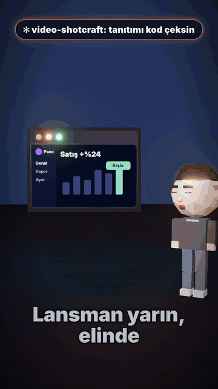
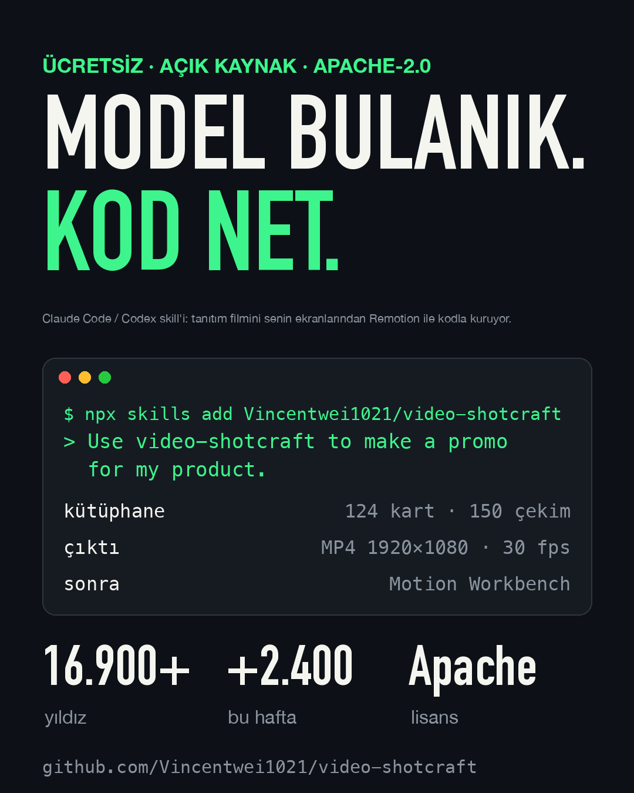

# Lansman yarın. Video modeli ürün ekranını bulanık bir çorbaya çevirdi.

16.900+ yıldız. Bu hafta +2.400. 150 çekim.

video-shotcraft.

Claude Code ve Codex için açık kaynak skill, tanıtım filmini üretmiyor, kodla kuruyor:
→ ajan sayfalarının gerçek görüntüsünü alıyor
→ 10 kategoride 124 tarif kartı / 150 çekimden seçip senaryo tahtası çiziyor
→ Remotion ile canlandırıyor, müziğin vuruşuna kesiyor, ses efekti ekliyor
→ her kareyi kontrol edip 1920×1080, 30 fps MP4 veriyor
→ her çekim bir React bileşeni: yazı değişince baştan üretim yok
→ teslimden sonra tarayıcıda CapCut benzeri Motion Workbench açılıyor
→ ses efektleri Freesound'dan (CC0 / CC BY filtreli), 5 hazır müzik

Kurulum:
npx skills add Vincentwei1021/video-shotcraft
Sonra: "Use video-shotcraft to make a promo for my product."

**📊 Rakamlarla:**
• 16.900+ yıldız
• +2.400 bu hafta
• Apache lisans

**⚙️ Nasıl başlarsın:**
$ npx skills add Vincentwei1021/video-shotcraft
> Use video-shotcraft to make a promo
  for my product.

**📌 Kısa notlar:**
• kütüphane: 124 kart · 150 çekim
• çıktı: MP4 1920×1080 · 30 fps
• sonra: Motion Workbench

**✨ Öne çıkanlar:**
• video üretici değil, her kare kodla çiziliyor
• teslimden sonra CapCut benzeri düzenleyici
• ses efekti Freesound'dan, CC BY künye ister

**📌 Lisans: Remotion bireylere ücretsiz, şirketler ücretli lisans isteyebilir.**

Tanıtım videonuzu model mi çizsin, kod mu?

[▶ Tam kalite video: video.mp4](video.mp4)

## Videoda adım adım

1. Adı video-shotcraft, Claude Code ve Codex için ücretsiz bir skill, tanıtım filmini Remotion ile kodla kuruyor.
2. Ajan sayfalarının gerçek görüntüsünü alıyor, 124 tarif kartından çekim seçip senaryo tahtasını çiziyor.
3. Sonra müziğin vuruşuna kesiyor, ses efektini ekliyor, her kareyi kontrol edip sana bitmiş video veriyor.
4. Kartlar 10 kategoride toplam 150 çekim, yazı maskesinden parçalara ayrılan sayfaya kadar.
5. Teslimden sonra tarayıcıda CapCut benzeri bir düzenleyici açılıyor, yazıyı ve rengi orada değiştiriyorsun.
6. Ses efektleri Freesound'dan iniyor, CC BY olanların künyesini yayında vermen gerekiyor.
7. Node, ffmpeg ve uv istiyor, üçü de bu bilgisayarda kurulu.
8. Kurmak için tek satır yeterli, sonra ürünüm için tanıtım filmi yap demen yetiyor.

## Kaynak

- https://github.com/Vincentwei1021/video-shotcraft

## Lisans

Bu depodaki video, kart ve metinler MIT lisanslıdır (LICENSE). Anlatılan aracın kendi lisansı kendi deposundadır.
